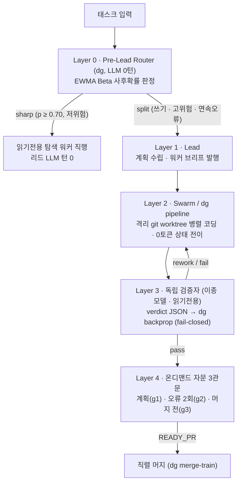
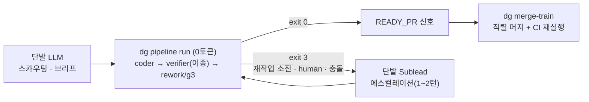

<div align="center">

# dgate

**실측 통계 기반 멀티 에이전트 오케스트레이터**  
*Decision Gate가 저비용 경로와 리드 승격 경로를 자동 분기하고, 0토큰 상태머신이 Sublead 파이프라인을 구동한다*

<p>
  
  <a href="#7-rust-v2-네이티브-cli--선택적-gpui-데스크톱-관제앱"></a>
  
  <a href="#7-rust-v2-네이티브-cli--선택적-gpui-데스크톱-관제앱"></a>
  
  <a href="LICENSE"></a>
</p>

<p>
  <a href="#30초-quick-start">Quick Start</a> ·
  <a href="#1-아키텍처-요약-pre-lead-gate--5계층">아키텍처</a> ·
  <a href="#3-모델구독-가변-설정-rosterjson--환경변수">Roster 설정</a> ·
  <a href="#4-타-로컬-저장소-공용-실행---repo--dg-cli">Sublead 파이프라인 &amp; CLI</a> ·
  <a href="#5-보안격리-설계">보안·격리</a> ·
  <a href="#6-dgate-tuiweb-관제-화면">TUI / Web / GPUI</a>
</p>

로컬 CLI 에이전트(`claude` · `codex` · `devin` · `pi` · `gemini` · `agy` · `custom`)를 5개 역할 슬롯(`lead` · `explore` · `coder` · `verifier` · `advisor`)에 자유 바인딩하고, SQLite 실측 통계가 안정된 태스크는 읽기전용 워커로 직행시켜 **리드 LLM 턴을 0으로** 만든다. 구독·쿼터가 바뀌면 `roster.json` 하나만 교체한다.

<!-- gitreels:start -->
<p align="center">
  <a href="https://gitreels.com/insightflo/dgate"></a>
  <br>
  <a href="https://gitreels.com"></a>
  <a href="https://gitreels.com/insightflo/dgate"></a>
</p>
<!-- gitreels:end -->

</div>

---

## 핵심 장점

<table>
  <tr>
    <td width="50%" valign="top">
      <h3>🎯 실측 통계 기반 Decision Gate</h3>
      SQLite(WAL) 위 EWMA Beta 사후확률로 태스크를 <code>sharp</code>(읽기전용 워커 직행, 리드 0턴)과 <code>split</code>(리드 승격)으로 자동 분기한다. 동일 조건 연속 오류 2회 시 강제 <code>split</code> 안전 폴백. 외부 npm 의존성 0개 — Rust 단일 워크스페이스.
    </td>
    <td width="50%" valign="top">
      <h3>⚙️ 0토큰 Sublead 파이프라인 &amp; 기본 병렬</h3>
      비겹침 독립 태스크가 2개 이상이면 기본값으로 격리 <code>git worktree</code> 병렬 실행한다. 웨이브 내부 전이(<code>coder → verifier → rework/g3 → READY_PR</code>)는 상주 LLM 없이 <code>dg pipeline run</code>(0토큰 상태머신)이 구동하고, 에스컬레이션 시에만 단발 LLM을 깨운다.
    </td>
  </tr>
  <tr>
    <td width="50%" valign="top">
      <h3>🖥️ 실시간 TUI · SSE 웹 · GPUI 관제</h3>
      Rust 네이티브 <code>dgate-tui</code>(ratatui) · <code>dg serve</code>(무의존성 localhost SSE 웹 — Dark 토폴로지 &amp; Light 팩토리 듀얼 뷰) · <code>dgate-gui</code>(GPUI 0.2.2). <code>hc</code> · <code>dg wrap</code> · <code>herdr agent list</code> · 단독 OS <code>ps</code> 프로세스와 로컬 git·디스크/RAM을 실시간 매핑한다.
    </td>
    <td width="50%" valign="top">
      <h3>🌐 크로스 플랫폼 &amp; ~3.7ms 네이티브 기동</h3>
      macOS · Linux · Windows 네이티브 지원(GitHub Actions 3-OS CI 검증). <code>npm run install:global</code> 한 번으로 어느 저장소에서든 <code>dgate-tui</code> · <code>dgate-gui</code> · <code>dg</code> · <code>dgate</code>를 즉시 실행한다.
    </td>
  </tr>
</table>

---

## 30초 Quick Start

요구 사항은 **Rust toolchain**(`cargo`) 하나. `cargo build --release --workspace` 한 번이면 `dg` · `dgate` · `dgate-tui` · `dgate-gui` 전부 빌드된다. *(전역 설치 스크립트 실행에는 Node.js 22.6+ 필요 — npm 의존성 0개)*

```bash
git clone https://github.com/insightflo/dgate.git && cd dgate
npm run build            # cargo build --release --workspace
npm run install:global   # ~/.local/bin에 dgate-tui · dgate-gui · dg · dgate 전역 설치
dgate-tui                # 실시간 관제 TUI 시작 — 또는 dg serve(localhost SSE 웹) / dgate-gui(GPUI 앱)
```

> [!TIP]
> **무침습 3모듈 독립 도입**: 전면 도입 없이 ① **모니터 단독**(`dgate-tui` · `dg serve` · `dgate-gui`, 레포 파일 수정 0건) ② **라우터 단독**(`dg route` · `dg suggest-session`) ③ **풀 오케스트레이터**(`dg dispatch` · `dg pipeline`) 중 필요한 모듈만 골라 쓸 수 있습니다. 레포 훅/계약 블록 설치는 명시 동의 opt-in이며, 첫 환경 설정은 `npm run setup`(0토큰 위저드)으로 끝납니다.

---

## 1. 아키텍처 요약 (Pre-Lead Gate + 5계층)



| 계층 | 역할 | 핵심 계약 |
| :--- | :--- | :--- |
| **Layer 0 · Pre-Lead Router** | `dg route` / `dg dispatch` (LLM 0턴) | 태스크 7종(`explore_read` · `code_search` · `single_edit` 등) 사후확률로 `sharp`/`split` 분기 |
| **Layer 1 · Lead** | 계획 수립 · 브리프 발행 · 직렬 머지 | `HERDR_DB_WRITE=1` 통계 기록, `merge_danger`·`--after` 게이트 유지 |
| **Layer 2 · Swarm / Pipeline** | 읽기전용 탐색 + worktree 병렬 코딩 | 비겹침 영역 기본 병렬, 웨이브 내부 전이는 `dg pipeline run`(0토큰) |
| **Layer 3 · 독립 검증자** | 이종 모델 · 읽기전용 교차 검증 | `.herdr/verify/<fork_id>-verdict.json` SSOT → `dg backprop` fail-closed 반영 (§5) |
| **Layer 4 · 온디맨드 자문** | 계획(g1) · 오류 2회(g2) · 완료(g3) 3관문 | 단일 판정 마커 응답 후 즉시 `hc kill; hc rm` 정리 |

> [!NOTE]
> **역할 분리 & 워커 실행 계약**  
> 판정·측정(`dg route` · 게이트 · `dg wrap` 텔레메트리 → `~/.local/state/dgate/decision.db` SSOT)은 `hc` 없이 단독 동작하고, 세션 제어(`hc run/wait/send/kill`)와 라이브 관제(TUI/GUI)는 `hc` 위에서 동작합니다. 모든 외부 워커는 `dg wrap`으로 감싼 뒤 `hc run --bg`로 띄우며(`nohup`/`disown` 분리·무래핑 실행 금지), 장기 무인 실행은 [docs/autonomous-run-contract.md](docs/autonomous-run-contract.md)를 따릅니다.

---

## 2. 요구사항 & 빠른 시작

### 요구사항

| 구분 | 항목 | 비고 |
| :--- | :--- | :--- |
| **필수** | **Rust toolchain** (stable) | `cargo build --release --workspace` 한 번으로 전체 바이너리 빌드 |
| **권장** | 로컬 CLI 에이전트 1종+ | `claude` / `codex` / `devin` / `pi` / `gemini` / `agy` / `custom` (없으면 `--dry-run`·로컬 통계 단독 사용) |
| **선택** | `hc` · `herdr-app` | 백그라운드 세션 제어 · 실시간 TUI/GUI 관제 |
| **선택** | Node.js 22.6+ | `npm run` 편의 스크립트 · `install:global` 전역 래퍼 설치 (외부 npm 의존성 0개) |

### 단독 실행 (외부 도구·API 키 없이 3줄 시작)

```bash
cargo build --release --workspace                                          # 또는 npm run build
./target/release/dg route --task-kind explore_read                          # sharp/split 라우팅 판정 (LLM 0턴)
./target/release/dg wrap --route tool_select --tool-class shell_exec -- echo hi  # 명령 감시 래핑
./target/release/dg stats --cost --timing && ./target/release/dg report     # 비용·타이밍 통계, 규칙 후보 리포트
```

- **실시간 TUI 모니터**: `npm run dgate-tui` *(현재 세션 관측 · 전체 프로젝트는 `-- --all`)*
- **GPUI 데스크톱 관제앱**: `npm run dgate-gui` ([§7](#7-rust-v2-네이티브-cli--선택적-gpui-데스크톱-관제앱))
- **에이전트 스킬 연동**: [skills/dgate/SKILL.md](skills/dgate/SKILL.md)

### 빠른 시작 (진단 → 리허설 → 테스트)

```bash
# 0) 환경 진단·온보딩 (0토큰 위저드 — 보유 CLI·모델 감지 + 맞춤 roster + 동반 스킬 추천)
npm run setup            # 대화형 위저드
npm run setup:check      # 읽기전용 진단 리포트만 (파일 쓰기 0)

# 1) 오케스트레이션 계획 리허설 (모델 호출 0회, 실기동 0회 — 무조건 안전)
./target/release/dg dispatch --task-kind multi_edit --repo . --dry-run

# 2) 전체 테스트 468건 — Rust 워크스페이스 458 + 설치 스크립트 10
npm test                 # = cargo test --workspace && node --test tests/*.test.ts

# 3) 데모 TUI 스냅샷 (DB·hc 없이 관제 화면 정적 출력)
npm run dgate-tui -- --snapshot
```

> [!NOTE]
> **TUI 관측 vs 제어**  
> `dgate-tui`의 `[읽기전용 관측 · WATCH]`는 **읽기전용 라이브 대시보드**입니다. 실제 태스크 제어는 AI 채팅에서 `dgate` 스킬(`"dgate로 진행해줘"`)로 하거나 별도 셸에서 `dg` 명령으로 수행합니다. 와이어 애니메이션은 워커가 실제 실행 중일 때만 움직이며 대기 시 정지합니다.

---

## 3. 모델·구독 가변 설정 (`roster.json` & 환경변수)

역할↔모델 바인딩은 전부 외부 설정으로 분리돼 있습니다. **구독·쿼터 상황이 바뀌면 설정 파일 하나만 교체합니다.**

```text
--roster <path>  >  HERDR_ROSTER_PATH  >  <repo>/.herdr/roster.json  >  ~/.config/herdr-quad/roster.json  >  내장 기본값 (quota-saver)
```

[`.herdr/roster.example.json`](.herdr/roster.example.json)을 복사해 자신의 환경에 맞게 편집합니다:

```bash
mkdir -p ~/.config/herdr-quad
cp .herdr/roster.example.json ~/.config/herdr-quad/roster.json
```

```jsonc
{
  "defaultProfile": "quota-saver",
  "profiles": {
    "quota-saver": {
      "roles": {
        "lead":     { "cli": "pi", "provider": "opencodex", "model": "<lead-model>", "thinking": "max" },
        "explore":  { "cli": "pi", "provider": "opencodex", "model": "<cheap-model>", "thinking": "medium", "readonly": true },
        "coder":    { "cli": "custom", "bin": "aider", "extraArgs": ["--no-auto-commits"] },
        "verifier": { "cli": "pi", "provider": "opencodex", "model": "<verifier-model>", "thinking": "max", "readonly": true },
        "advisor":  { "cli": "pi", "provider": "opencodex", "model": "<advisor-model>", "thinking": "high", "readonly": true, "onDemand": true, "quotaBucket": "pi" }
      }
    }
  }
}
```

- 미지정 필드는 내장 기본값을 상속(부분 오버라이드 허용)하며, `"cli": "custom"`으로 임의의 로컬 터미널 CLI(`codex` · `opencode` · `aider` 등)를 바인딩할 수 있습니다.
- 실행 파일 해석 순서: `bin` 필드 → 환경변수 → `PATH` 탐색 → 관례적 설치 위치(`~/.bun/bin/pi`, `~/.local/bin/agy`).
- `pricing.relativeCost`(선택) 지정 시 `dg route`/`dg gate`가 상수 `0.70` 대신 비용 인식 동적 `θ_sharp`를 산출합니다(§5).

| 내장 프로필 | 구성 | 비고 |
| :--- | :--- | :--- |
| `quota-saver` *(기본)* | lead · verifier · advisor 모두 `pi` (advisor 온디맨드) | `agy` 상시·온디맨드 모두 0 |
| `agy-quad` *(opt-in)* | lead · verifier · advisor 모두 `agy` 상시 | 일일 예산 초과 시 `quota-saver`로 자동 강등 |

<details>
<summary><b>환경변수 전체 참조 (11종)</b></summary>

| 변수 | 용도 |
| :--- | :--- |
| `DGATE_DB_PATH` | 결정 엔진 SQLite DB 경로 (기본 `~/.local/state/dgate/decision.db`, 레거시 별칭 `DECISION_ORCHESTRATOR_DB_PATH`·`GEMINI_TRICK_DB_PATH`) |
| `HERDR_ROSTER_PATH` | `roster.json` 경로 오버라이드 |
| `PI_BIN` / `HERDR_PI_BIN` | `pi` 실행 파일 경로 오버라이드 |
| `AGY_BIN` / `DEVIN_BIN` / `HC_BIN` / `CLAUDE_BIN` | 각 CLI 실행 파일 경로 오버라이드 (`"cli": "custom"`은 자체 `bin` 필드 사용) |
| `HERDR_AGY_TURN_BUDGET` | `agy` 일일 턴 예산 (기본 20 — 초과 시 프로필 자동 강등) |
| `DECISION_API` | Decision API 모드 — `off`(기본, 네트워크 0) / `shadow`(병행 평가·로컬 불변) / `on`(콜드스타트 `basis:prior`만 적용) |
| `GEMINI_DECISION_API_KEY` | Decision API 인증 키 — `x-goog-api-key` 헤더로만 전송(URL `?key=` 미사용). 부재 시 `off` 강등 |
| `DECISION_API_BASE_URL` | 엔드포인트 오버라이드 (기본 `https://generativelanguage.googleapis.com`, `POST {base}/v1beta/decisions`) |
| `DECISION_API_MODEL` | 모델 오버라이드 (기본 `gemini-decision-1`) |
| `DECISION_API_TIMEOUT_MS` | 요청 타임아웃 ms (기본 3000, 50–30000 클램프) |

`dg route`/`dg gate`/`dg dispatch`는 `--decision-api off|shadow|on`, `--context <text>`, `--api-eval` 플래그를 지원합니다. 모든 실패는 로컬 EWMA로 fail-safe 폴백하며 `decision_events`를 오염시키지 않습니다.

> [!CAUTION]
> **API 키는 절대 이 저장소에 커밋하지 않습니다.** 키 주입은 환경변수로만 수행하며 `.env*` 파일은 `.gitignore`로 차단돼 있습니다.

</details>

---

## 4. 타 로컬 저장소 공용 실행 (`--repo`) & `dg` CLI

저장소 단위 다중 task·PR 위임 개발 플레이북은 [docs/WORKFLOW.md](docs/WORKFLOW.md)를 참고합니다. `dg` · 역할 계약서 · roster는 오케스트레이터 루트 기준, 작업 cwd · worktree · `project_id`는 `--repo` 기준으로 해석됩니다.

```bash
dg dispatch --task-kind multi_edit --repo /path/to/your-project --dry-run
```

### Sublead 0토큰 파이프라인 · 기본 병렬 실행 · 직렬 머지 트레인



- **`dg pipeline init|step|status|run`** — 상주 sublead LLM의 기계적 상태 전이 토큰 낭비(~70%)를 없애는 **0토큰 결정적 상태머신**([docs/sublead-pipeline-design.md](docs/sublead-pipeline-design.md)). `.herdr/pipelines/<run_id>.json` 기반으로 `coder → verifier(이종 모델 강제) → rework(backprop + 재스폰) → advisor-g3 → READY_PR`까지 자동 구동하고, 예산 소진·`verdict=human`·프로토콜 위반 시에만 `exit 3`으로 단발 에스컬레이션을 트리거합니다(`--dry-run` 리허설, macOS/Linux + Windows `cmd /C` 네이티브 지원).
- **`dg suggest-sublead`** — `decision.db` 3축 신호(리드 부하·영역 분리·작업 범위) 또는 착수 전 `--scopes <p1,p2,...>`로 비겹침 병렬 그룹 수와 sublead 분리 여부를 LLM 호출 0회로 판정합니다([docs/sublead-design.md](docs/sublead-design.md)). 비겹침 독립 태스크가 2개 이상이면 기본값으로 격리 worktree 병렬 실행을 권장합니다.
- **`dg suggest-session`** — 코더 세션의 **에페머럴(1작업 1세션) vs Warm 재사용(프롬프트 캐시 활용)**을 LLM 호출 0회로 판정합니다. `verifier`/`advisor`는 항상 에페머럴, 투입 전 3초 필터(`door=one-way`·파일 ≥6·도메인 불일치·대기 <3건 → 에페머럴), 실행 중 자동 리셋선(연속 실패 2회·컴팩션 발생·5작업/35턴·DB 1차 통과율 <70%)을 기계적으로 적용합니다.
- **`dg merge-train`** — strict 브랜치 보호 환경에서 `READY_PR`들을 직렬 머지하며 CI 재실행·sublead 머지 금지 가드를 함께 적용합니다.

### 디스패처 게이트 — `--brief-file` · `--after <fork_id>`

- **`--brief-file <path>`(검증자 브리프)** — `## Standards` · `## Spec` · `## Merge Danger` 헤딩 3종, `door: one-way|two-way`, 비어있지 않은 `blast_radius:`(≤500자), ≤64KB·UTF-8을 입구에서 기계 검증합니다(위반 시 `exit 2`, strict 모드에서 필수). 템플릿: [docs/verifier-brief-template.md](docs/verifier-brief-template.md).
- **`--after <fork_id>`(fork 의존성 ready-frontier)** — 선행 fork가 살아 있으면(`open`·`waiting_human`) 발행을 미루고(`deferred:true`), 닫힌 뒤 정상 발행하며 `metadata_json.after_fork`에 기록합니다.

<details>
<summary><b><code>dg</code> 서브커맨드 26종 전체 참조</b></summary>

```bash
dg <command> [flags]
```

| 명령 | 용도 |
| :--- | :--- |
| `route` | 태스크 종류별 `sharp`/`split` 라우팅 판정 (LLM 턴 0). `--roster`/`--profile` 지정 시 비용 인식 동적 `θ_sharp` 적용 |
| `gate` | 게이트 진입 시 사후확률·강제 조건 평가 (`--roster`/`--profile` 동적 `θ_sharp` 연동) |
| `close` | fork 종료 처리 (`--outcome ok\|fail\|rerouted`) |
| `touch` | fork TTL 갱신 (워커 하트비트) |
| `record` | 도구 사용 결과 표본 기록 (EWMA 입력) |
| `backprop` | 검증 `[FAIL]`을 원본 fork에 역전파 — 수동 또는 `--verdict-file` 구조화 판정 적용(fail-closed) |
| `attempt` | fork `generation`·`attempt` 펜스 조회·증가 (`--bump-gen`, DDL v2) |
| `retro` | fork 회고 마크다운(상태·원인·실패 도구·권고)을 다음 워커 브리프용으로 생성 |
| `settle-orphans` | TTL 만료 fork 일괄 정산 |
| `wrap` | 워커 커맨드 래핑 — 워치독 감시·산출물 계약·원자 커밋으로 SSOT 기록 (§5). `--stall-action warn`은 무출력 임계 초과 시 킬 대신 경고만 출력 |
| `serve` | `--port 4747` · `--repo <dir>` · `--poll-ms 1500` — localhost 전용 실시간 SSE 웹 대시보드 (Dark 토폴로지 · Light 팩토리 듀얼 뷰, §6) |
| `stats` | 비용·실행/대기 시간 통계 (`--cost`·`--timing`·`--days`·`--db`) — 완전 읽기전용, 구간 합집합으로 병렬 중복 제거 |
| `checkpoint` | 워크트리 체크포인트 `create\|verify\|restore` — git 패치+untracked 스냅숏, sha256 manifest 검증 |
| `worktree` | `worktree remove` — 체크포인트 검증 통과 전 삭제 물리 차단 (`exit 4`, 우회 불가) |
| `report` | 읽기전용 규칙 후보 리포트 (`--days`·`--out`) — `--out`은 `<repo>/.herdr/report/` 또는 저장소 외부만 허용 |
| `compact` | 결정 DB 압축·통계 정리 |
| `hook` | `--guard`(stdin JSON → deny/allow, fail-closed 읽기전용 가드) · `--collect`(PostToolUse 텔레메트리, fail-open) |
| `setup` | `--check`·`--json`·`--repo <dir>` — 설치·훅 상태 점검 |
| `dispatch` | `--task-kind <k>` 판정으로 fork 발급(`dispatch:true` 메타데이터) + 워커 커맨드 생성. `--brief-file <p>`·`--after <fork_id>` 게이트 (§4) |
| `dispatch-mode` | `--set off\|strict` — strict: delegate_swarm wrap은 dispatch 발급 `--fork`만 허용 |
| `send` | `<addr> <message…>` — hc send + 전달 확인·재전송, 미확인 exit 1 |
| `reap` | `--minutes 30`·`--dry-run` — 종료 터미널 유휴 창 경과 후 자동 정리 (sublead 컨텍스트는 자기 하위 트리만 스코핑) |
| `pipeline` | `init\|step\|status\|run [--dry-run]` — 0토큰 결정적 sublead 상태머신(`coder→verifier→rework/g3→READY_PR`, 에스컬레이션 `exit 3`) |
| `merge-train` | 직렬 머지 트레인 — CI 재실행 확인 및 sublead 머지 차단 가드 |
| `suggest-sublead` | `--project <dir>` 또는 `--scopes <p1,p2,...>` — 3축 신호 기반 sublead 분리·병렬 배치 추천 (LLM 0호출) |
| `suggest-session` | `--role` · `--door` · `--files` · `--same-domain` · `--queued` · `--compacted` — 하이브리드 세션 수명 정책(`ephemeral` vs `warm_reuse` + 리셋 판정, LLM 0호출) |

</details>

---

## 5. 보안·격리 설계

| 보호 계층 | 동작 방식 |
| :--- | :--- |
| **Fail-Closed 읽기전용 가드** | `.agents/hooks.json`의 `dg hook --guard`가 `HERDR_READONLY=1` 워커의 쓰기·위임·위험 플래그(`--dangerously-skip-permissions` 등)·제어문자 주입을 사전 차단(가드 오류 시에도 차단) |
| **Fail-Open 수집** | `PostToolUse` 텔레메트리 수집 실패는 워커 실행을 막지 않음 |
| **읽기전용 도구 제한** | `pi` 탐색 워커는 `--tools read,grep,find,ls` 고정 + `--exclude-tools edit,write` 자동 부여 |
| **세션명 충돌 방지 & Dry-Run 무오염** | `^[a-z0-9_-]{1,32}$` + 6-hex 접미 · `hc ls` 사전 충돌 점검, `--dry-run`은 `:memory:` DB 사용 |

<details>
<summary><b>실행 수명주기 &amp; <code>dg wrap</code> 워치독</b></summary>

`dg wrap`이 워커 자식을 `detached` 프로세스 그룹으로 띄워 종료 코드·신호·출력 tail을 함께 수집하고, 결과를 `commitWrapOutcome` 단일 트랜잭션으로 SSOT에 기록합니다(이중 표본·TOCTOU 차단). `--expected-gen`/`--expected-attempt` 펜스로 세대·시도 불일치의 stale 커밋을 거부하고, 디스패처는 `repo_scope` cooperative lease로 동일 저장소를 점유 중인 세션과의 중복 디스패치를 미룹니다.

- **산출물·출력 계약** — `--require-artifact <path>`, `--require-nonempty`, `--require-stdout-nonempty`를 clean exit(0) 시 AND 게이트로 검사. stdout 첫 비공백 줄이 `rerouted`면 리드 승격 신호로 닫힘.
- **워치독** — `--stall-ms`(기본 300s, `DGATE_STALL_MS` 오버라이드) 무출력 스톨 시 `--stall-action kill`(기본, 프로세스 그룹 SIGTERM→SIGKILL + 리덕션 20줄 tail 보존) 또는 `--stall-action warn`(킬 없이 경고만 출력, `DGATE_STALL_ACTION`), `--max-ms`(기본 20분) 총 시간 상한, `--heartbeat-ms`(기본 60s) TTL 갱신.
- **`FailureCause` 11종** — `ok_pass`·`transient_network`·`tool_error`·`max_turns`·`no_result`·`artifact_missing`·`gate_fail`·`stall`·`timeout`·`config_error`·`interrupted`. `config_error`·`interrupted`·환경류 오류는 EWMA 오염에서 격리되고 `ttl_orphan` 정산은 w=1.0 실패 표본을 강제합니다.

</details>

<details>
<summary><b>Fail-Closed 구조화 Verdict &amp; <code>dg retro</code></b></summary>

- **`.herdr/verify/<fork_id>-verdict.json`** — `schema_version: 1`, `decision`: `pass|rework|fail|human`, `findings[].severity`: `P0|P1|P2|info`. `dg backprop --verdict-file <path> [--expected-head <sha>] [--max-reworks 2]`가 스키마·fork_id/HEAD 결속·모순 판정 3중 불변식을 검증합니다(무효·Stale·Replay·`human`은 `exit 3` + `waiting_human` 파킹).
- **`dg retro --fork <id> [--out <path>]`** — fork의 상태·원인·실패 도구 상위 5건·다음 시도 권고를 리덕션 마크다운으로 생성해 다음 워커 브리프에 주입(opt-in).
- **`merge_danger`(선택 필드)** — `{"door":"one-way|two-way","blast_radius":"≤500자"}`. strict 모드에서는 유효 verdict에 필수(`exit 2` 거부).

</details>

<details>
<summary><b>DDL v2 무중단 마이그레이션 · 비용 인식 라우팅 · 시간 통계</b></summary>

- **`PRAGMA user_version = 2` 자동 승격** — v1 DB를 열 때 `VACUUM INTO` 백업 후 단일 트랜잭션으로 `forks` 리빌드·백필·`fork_intervals` 추가(`dg attempt`로 세대·시도 관리).
- **비용 인식 동적 `θ_sharp`** — `pricing.relativeCost`와 쿼터 희소도 승수 `κ_quota`로 `θ_sharp = clamp((C_eff(explore)+C_switch)/(C_eff(lead)+C_switch), 0.70, 0.90)` 산출.
- **`dg stats` 실행/대기 시간 분리** — `fork_intervals`의 exec/wait/human 구간을 합집합으로 합산해 병렬 워커 중복 제거(완전 읽기전용).

</details>

<details>
<summary><b>Git-Native 워크트리 체크포인트 &amp; 삭제 게이트 · 규칙 후보 리포트</b></summary>

- **`dg checkpoint create|verify|restore`** — staged/unstaged `git diff --binary` 패치와 untracked 원본(파일당·총합 12MiB 상한)을 `.herdr/checkpoints/<run_id>/<wt_name>/`에 스냅숏하고 sha256 manifest 검증.
- **`dg worktree remove` 삭제 게이트** — 체크포인트 저장 + verify 통과 전에는 삭제에 물리적 도달 불가(우회 플래그 없음, 거부 시 `exit 4`).
- **`dg report [--days 14] [--out <path>]`** — 도구 반복·핑퐁·FailureCause·고아/스톨 4종 규칙 후보를 읽기전용(`PRAGMA query_only`)으로 출력(프롬프트·코드·DB 자동 변조 영구 금지).

</details>

<details>
<summary><b>시크릿 3중 방어</b></summary>

- **헤더 전용 키 전달** — `x-goog-api-key` 헤더 전용(`?key=` URL 쿼리 폐기).
- **자식 env 최소 격리** — `buildSanitizedChildEnv` · `dg wrap --sanitize-env --allow-env K1,K2`로 `*_API_KEY|_TOKEN|_SECRET|_PASSWORD|_PRIVATE_KEY` 제거.
- **전역 리덕션** — `redactSecrets`(무예외 순수 함수)가 로그·`error_snippet`·`command_line`·verdict/retro 출력 전반에서 키·토큰을 `<redacted>`로 치환.

</details>

---

## 6. dgate TUI/Web 관제 화면

읽기전용 라이브 관제 TUI/Web입니다. `roster.json` 변경을 핫리로드로 반영하고, 실행 중인 `hc` 세션·`dg wrap` 백그라운드 프로세스·독립 OS AI CLI 프로세스에서 직접 읽은 **`cli · model · effort` 실측 텔레메트리**를 실시간으로 표시합니다.

- **Sublead 클러스터 & 루트 PID 귀속** — 중첩 `hc run --bg -- dg wrap` 자식 워커도 루트 PID(`wrap_pid == terminal.pid`)까지 추적해 소유 sublead 클러스터(`↳ sublead-*` 배지)에 자동 귀속합니다.
- **활성 코더 우선 노출 & 오버플로 스크롤** — Workers 그리드는 **활성 클러스터(코더) → 미소속 워커 → 빈 sublead** 순으로 정렬하고, `←/→` 가로 슬라이딩 창으로 `+N개 더` 오버플로 카드까지 탐색합니다.
- **내장 서브에이전트 경고** — 리드가 내장 서브에이전트(`invoke_subagent`)를 호출하면 Lead 카드에 관측 불가 경고 배지를 띄웁니다.
- **localhost SSE 웹 대시보드 (`dg serve`)** — `dg serve [--port 4747] [--repo <dir>]`는 외부 크레이트 0개·100% 로컬 전용(`127.0.0.1`)으로 `GET /` · `/api/snapshot` · `/api/stream`(SSE)을 제공합니다. **토폴로지(Dark)** 와 **팩토리(Light 컨트롤 타워)** 듀얼 뷰를 상단에서 즉시 전환하며, 두 뷰가 공유하는 SVG 연결선 스튜디오(`bezier`·`rounded`·`bus` + `packet`·`comet`·`particle`·`chevron` + 테마 인식 케이싱/포트 도트)와 4탭 인스펙터(**로컬 상태**·**실시간**·**매핑 설계**·**상세·로그** — 호스트 Disk/RAM, 로컬 git·워크트리·`.herdr/pipelines`, `ps`/`hc`/`herdr` 프로세스 매핑)를 내장합니다.
- **시각 계층 & 임계선 마커** — TUI · Web · GPUI 공통으로 Decision Gate 바에 `θ_sharp`(0.70) 임계선 마커를 표시하고, 하단 `다시 Lead` 카드에 실측 `PASS · rework · fail · human` 요약, 활성/대기 노드 광도 분리, 중복 벤더 모델명 자동 축약을 적용했습니다.

```bash
npm run dgate-tui                        # 기본 관제 TUI (현재 세션 · 기본 DB 자동 연결, 전체는 -- --all)
npm run dgate-gui                        # GPUI 데스크톱 관제앱 (cargo run -p dgate-gui)
dg serve --port 4747                     # localhost SSE 웹 대시보드 (--repo <dir>로 저장소 범위 제한 가능)
dgate-tui --repo /path/to/your-project   # 저장소 단위 모니터 (--repo <dir>)
dgate-tui --demo                         # 내장 데모 데이터 렌더 (DB·hc 없이)
dgate-tui --snapshot                     # 현재 상태 정적 스냅샷 출력
```

| 단축키 | 동작 |
| :--- | :--- |
| `Tab` | 패널 포커스 이동 |
| `←` / `→` | 워커 카드 선택 이동 (`+N개 더` 오버플로 가로 팬) |
| `Enter` | 선택 워커 상세 모달 |
| `a` | 전체 / 현재 레포 필터 토글 |
| `r` · `?` · `q` | 즉시 새로고침 · 도움말 · 종료 |

---

## 7. Rust v2 네이티브 CLI & 선택적 GPUI 데스크톱 관제앱

dgate의 **유일한 구현체**입니다(Node v1 제거 완료, [docs/v2-ssot-migration.md](docs/v2-ssot-migration.md)). Cargo 워크스페이스로 코어·CLI·TUI·GUI가 크레이트 단위로 분리돼 있어 **CLI/헤드리스 빌드는 GUI 의존성을 전혀 컴파일하지 않습니다.**

```toml
default-members = ["crates/dgate-core", "crates/dgate-cli"]
```

- `cargo build --release` → 네이티브 `target/release/dg` · `target/release/dgate` 생성(**~3.7ms 기동**, macOS·Linux·Windows).
- **SQLite DDL v2 단일 SSOT** — `~/.local/state/dgate/decision.db` 하나를 CLI·TUI·GUI가 공유하며 v1 DB도 자동 승격합니다.
- 편의 스크립트: `npm run rust:build` / `npm run rust:test` *(npm 의존성 0개)*.

### 선택적 GPUI 네이티브 데스크톱 관제앱 (`crates/dgate-gui`)

[gpui 0.2.2](https://github.com/longbridge/gpui) 기반 GPU 가속 네이티브 앱(macOS·Windows, 완전 선택 사항):

```bash
npm run gui:build    # = cargo build -p dgate-gui
npm run dgate-gui    # = cargo run -p dgate-gui --
# 또는 직접:
cargo run -p dgate-gui -- [--repo <dir>] [--db <path>] [--roster <path>] [--watch-only] [--poll-ms 2000]
```

- **저장소별 탭** & **패널 드래그 리사이즈** (advisor·verifier 폭, 로그 높이)
- **5-역할 로스터 카드 + 라이브 실측 텔레메트리** & **Sublead 클러스터 그룹핑** (TUI와 동일 계약)
- **Decision Gate 확률 바 + 비용/타이밍/shadow 요약** & **2단계 명시 확인 워커 정지**

### 테스트

| 대상 | 테스트 수 | 실행 명령 |
| :--- | :--- | :--- |
| **Rust 워크스페이스** | **458건** (`core` 325 · `cli` 32 · `e2e` 11 · `gui` 45 · `tui` 45) | `cargo test --workspace` |
| **전역 설치 스크립트** | **10건** (래퍼 생성 · 멱등 · win32 계약) | `node --test tests/install-global.test.ts` |

`npm test`로 468건 전수를 한 번에 실행합니다.

---

## 라이선스·크레딧

- **라이선스** — [MIT License](LICENSE)
- **TUI 원조** — 관제 TUI는 [leecg39/Gemini_trick](https://github.com/leecg39/Gemini_trick)에서 출발해 Decision Gate·roster·읽기전용 격리 계약을 통합·일반화했습니다.
- **설계 영감** — LoopForge의 실행 가드레일·체크포인트·텔레메트리 패턴.
- **선택 동반 스킬** *(각 저장소 라이선스 적용)*: [mistology](https://github.com/chldbwnstm/mistology) · [NeverStuck](https://github.com/chldbwnstm/NeverStuck) · [todo-flow](https://github.com/JakeB-5/todo-flow) · [Effort-Router](https://github.com/acc0mplish/Effort-Router)
